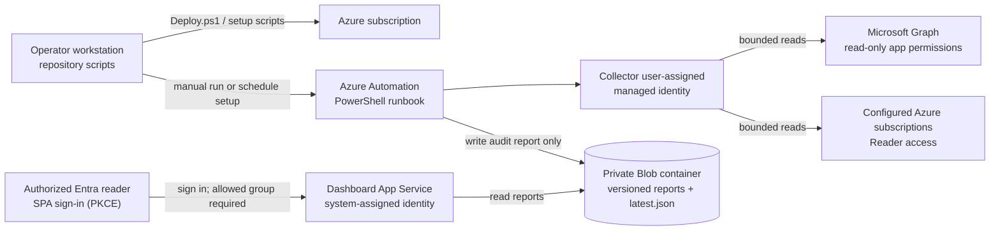

# Microsoft Entra ID Tenant Audit

A read-only, scheduled or operator-triggered tenant audit built around Azure Automation PowerShell 7.2, managed identity, Azure RBAC, and a private Blob container. An optional Node.js dashboard reads reports with its own managed identity and validates Microsoft Entra access tokens; it does not use storage keys or client secrets.

> **Coverage is intentionally honest.** The collector provides bounded inventories for users, groups, Conditional Access policies, service principals, app registrations, configured Azure subscription resources/RBAC, and managed identities. Other requested domains are represented with explicit `not_configured` or `partial` coverage until their integration, permissions, or implementation is supplied. Do not interpret missing records as proof of no access or no activity.

## Quick start

1. Review [architecture](docs/architecture.md), [permissions](docs/permissions.md), and the [threat model](docs/threat-model.md).
2. Install PowerShell 7.2+, Azure CLI with Bicep, Node.js 22+, and the Pester and PSScriptAnalyzer PowerShell modules. Automation module versions are listed in [config/automation-modules.json](config/automation-modules.json).
3. Create a dedicated resource group and run `scripts\Deploy.ps1 -SubscriptionId <subscription-id> -ResourceGroupName <name> -Location <region> -WhatIf`. Review the what-if output, then deploy explicitly with `-Deploy`.
4. Assign only the approved Graph application permissions to the automation user-assigned managed identity using `scripts\Grant-GraphPermissions.ps1`. This is a privileged, separate operator step.
5. Import/publish the runbook (the publish script packages the repository modules into the runbook), verify its runtime modules, configure subscription IDs and storage settings, and run it manually before creating/enabling a schedule. See [deployment](docs/deployment.md).
6. For the dashboard, register a single-tenant Entra app as a public SPA, configure its redirect URI and group claim, set the dashboard application settings, and assign the reader group. See [dashboard README](src/dashboard/README.md).

CI does not deploy Azure resources, grant permission consent, or activate a schedule. The dashboard sign-in shell is publicly reachable, but report APIs require an authorized Entra token and reader-group membership. No tenant data belongs in GitHub.

## Step-by-step deployment and use

Run the operator commands below from a trusted admin workstation with PowerShell 7.2+, from the repository root. These are not run inside the Automation account. The deployment identity needs Azure permissions to deploy the listed resources and create the storage role assignments; tenant Graph consent and Azure subscription access are separate, deliberate setup steps. Review [deployment](docs/deployment.md), [permissions](docs/permissions.md), and [dashboard setup](src/dashboard/README.md) before starting.

### How the pieces work together



The storage container is private and report APIs require a validated Entra token and the configured reader group. The sign-in shell itself is publicly reachable, and the current Bicep leaves the Storage network endpoint enabled; this is **not** a private-network deployment. See [architecture](docs/architecture.md) and [threat model](docs/threat-model.md) for boundaries and limitations.

### 1. Prepare Azure and preview infrastructure

Create a dedicated, empty resource group in the subscription where the audit resources will live. `Deploy.ps1` selects the subscription, compiles the Bicep template, and runs what-if; it does not create a schedule or run an audit.

```powershell
$subscriptionId = '<SUBSCRIPTION_ID>'
$resourceGroup = '<DEDICATED_RESOURCE_GROUP>'
$location = '<AZURE_REGION>'

az login
az account set --subscription $subscriptionId
az group create --name $resourceGroup --location $location

.\scripts\Deploy.ps1 -SubscriptionId $subscriptionId -ResourceGroupName $resourceGroup -Location $location -WhatIf
```

Review the planned changes and confirm the resource group is dedicated to this audit. Then explicitly deploy:

```powershell
.\scripts\Deploy.ps1 -SubscriptionId $subscriptionId -ResourceGroupName $resourceGroup -Location $location -Deploy
```

The script asks you to type `DEPLOY`. Record the deployment outputs: Automation account, collector identity client/principal IDs, storage account and report container, dashboard App Service name/URL, and dashboard identity principal ID. In the examples below, substitute those outputs for the placeholders.

### 2. Approve runtime access explicitly

First review the permission matrix and choose only the approved Graph application permissions the collectors actually require. Preview the request (no grant is made without `-Apply`):

```powershell
$tenantId = '<TENANT_ID>'
$collectorPrincipalId = '<COLLECTOR_MANAGED_IDENTITY_PRINCIPAL_ID>'
$graphPermissions = @('User.Read.All', 'Group.Read.All', 'GroupMember.Read.All', 'Policy.Read.All', 'Application.Read.All', 'AuditLog.Read.All')

.\scripts\Grant-GraphPermissions.ps1 -TenantId $tenantId -ManagedIdentityPrincipalId $collectorPrincipalId -Permission $graphPermissions
```

After an authorized administrator reviews and approves the exact set, apply it as a separate action:

```powershell
.\scripts\Grant-GraphPermissions.ps1 -TenantId $tenantId -ManagedIdentityPrincipalId $collectorPrincipalId -Permission $graphPermissions -Apply
```

The script asks you to type `GRANT`. It uses privileged Graph setup permissions and makes app-role assignments; it is a bootstrap tool, **not** a read-only audit operation. Do not grant permissions just because they appear in an example. `AuditLog.Read.All` is needed for sign-in log collection and is subject to tenant licensing/retention; omit it if that collection is not approved.

Separately assign the collector identity **Reader** on each configured subscription. Repeat this command for every subscription in `$subscriptionIds`; it grants Azure read access and is distinct from Graph permission consent:

```powershell
$subscriptionIds = @('<AUDIT_SUBSCRIPTION_ID>')
foreach ($scopeSubscription in $subscriptionIds) {
    az role assignment create --assignee-object-id $collectorPrincipalId --assignee-principal-type ServicePrincipal --role Reader --scope "/subscriptions/$scopeSubscription"
    if ($LASTEXITCODE -ne 0) { throw "Could not assign Reader on subscription $scopeSubscription" }
}
```

Run that assignment as an authorized Azure operator, and only for subscriptions you intend to audit. The Bicep already scopes report-write access to the report container for the collector and report-read access to that container for the dashboard identity.

### 3. Configure modules and import/publish the runbook

In an authenticated PowerShell session with the Az Automation module available, import the pinned Automation modules listed in [config/automation-modules.json](config/automation-modules.json), and wait until their provisioning state is successful:

```powershell
$account = '<AUTOMATION_ACCOUNT_NAME>'

New-AzAutomationModule -ResourceGroupName $resourceGroup -AutomationAccountName $account -Name Az -ContentLinkUri 'https://www.powershellgallery.com/api/v2/package/Az/16.4.0'
New-AzAutomationModule -ResourceGroupName $resourceGroup -AutomationAccountName $account -Name Microsoft.Graph.Authentication -ContentLinkUri 'https://www.powershellgallery.com/api/v2/package/Microsoft.Graph.Authentication/2.25.0'
```

Import the repository runbook and bundled collector modules as a draft:

```powershell
.\scripts\Publish-Runbook.ps1 -ResourceGroupName $resourceGroup -AutomationAccountName $account
```

In the Azure portal, associate the imported draft with the intended Automation runtime environment and verify its PowerShell version and modules. Then publish it as a separate, confirmed action:

```powershell
.\scripts\Publish-Runbook.ps1 -ResourceGroupName $resourceGroup -AutomationAccountName $account -Publish
```

This script's `-Publish` switch publishes the already-imported draft; it does not perform the runtime association. PowerShell 7.2 is out of support, so review the runtime warning in [deployment](docs/deployment.md) before production.

### 4. Configure and deploy the dashboard

Register/configure the single-tenant SPA and API, HTTPS redirect URI, delegated scope, group claim, and authorized reader group as described in [dashboard setup](src/dashboard/README.md). Set the identifiers on the App Service (they are not secrets), then package and deploy from the repository root:

```powershell
$dashboardApp = '<DASHBOARD_APP_NAME>'

az webapp config appsettings set --resource-group $resourceGroup --name $dashboardApp --settings DASHBOARD_TENANT_ID=$tenantId DASHBOARD_CLIENT_ID='<SPA_CLIENT_ID>' DASHBOARD_AUDIENCE='api://<API_CLIENT_ID>' DASHBOARD_ALLOWED_GROUP_ID='<READER_GROUP_ID>'
Push-Location .\src\dashboard
npm ci --omit=dev
Compress-Archive -Path .\* -DestinationPath ..\..\dashboard.zip -Force
Pop-Location
az webapp deploy --resource-group $resourceGroup --name $dashboardApp --src-path .\dashboard.zip --type zip
Remove-Item .\dashboard.zip
```

Verify the app loads over HTTPS, unauthenticated report API calls return `401`, a signed-in user outside the allowed group gets `403`, and an authorized reader can load a report. Do not put report data, storage keys, or tokens in the repository or browser configuration.

### 5. Run a manual audit before scheduling

Provide the runbook with explicit scope and bounded query settings. `Invoke-ManualAudit.ps1` signs in to Azure, asks you to type `RUN`, and starts an Automation job; collection then uses the configured user-assigned managed identity.

```powershell
$runParameters = @{
    TenantId = $tenantId
    StorageAccountName = '<STORAGE_ACCOUNT_NAME>'
    ReportContainer = 'audit-reports'
    SubscriptionIds = @('<SUBSCRIPTION_ID>')
    LookbackDays = 30
    UserAssignedIdentityClientId = '<COLLECTOR_MANAGED_IDENTITY_CLIENT_ID>'
}

.\scripts\Invoke-ManualAudit.ps1 -ResourceGroupName $resourceGroup -AutomationAccountName $account -RunbookName 'Invoke-EntraTenantAudit' -Parameters $runParameters
```

Use the returned job ID to inspect job status/output in the Automation account. Check the report in the dashboard and verify section status, warnings, coverage, timestamps, and configured scope; missing data is not evidence of no access or activity.

### 6. Enable a recurring schedule only after review

The schedule script prints a preview and makes no change unless `-Enable` is specified. Choose an appropriate future start time and time zone:

```powershell
$scheduleStart = [datetime]::UtcNow.AddHours(1)
.\scripts\Set-AuditSchedule.ps1 -ResourceGroupName $resourceGroup -AutomationAccountName $account -RunbookName 'Invoke-EntraTenantAudit' -ScheduleName 'EntraTenantAuditDaily' -StartTime $scheduleStart -DayInterval 1 -TimeZone 'UTC' -Parameters $runParameters
.\scripts\Set-AuditSchedule.ps1 -ResourceGroupName $resourceGroup -AutomationAccountName $account -RunbookName 'Invoke-EntraTenantAudit' -ScheduleName 'EntraTenantAuditDaily' -StartTime $scheduleStart -DayInterval 1 -TimeZone 'UTC' -Parameters $runParameters -Enable
```

The enabled command asks you to type `ENABLE`. To pause collection, disable the schedule/runbook association in the Automation account before removing resources.

### 7. Teardown and report retention

Before teardown, disable the schedule, decide whether reports must be exported/retained under your policy, and remove the Graph app-role assignments separately after checking dependencies. Preview the resource-group safety checks:

```powershell
.\scripts\Remove-Deployment.ps1 -ResourceGroupName $resourceGroup -ExpectedTagValue EntraTenantAudit -WhatIf
```

Only for a dedicated resource group containing this audit deployment, and only after addressing report retention, run the deletion command:

```powershell
.\scripts\Remove-Deployment.ps1 -ResourceGroupName $resourceGroup -ExpectedTagValue EntraTenantAudit
```

The script checks expected resource types/tags and asks you to type `DELETE <RESOURCE_GROUP_NAME>`. Successful removal deletes the resource group and its report data; the script does not remove Graph app-role assignments.

### Operator scripts at a glance

| Script | Run from / purpose | Action gate |
|---|---|---|
| [Deploy.ps1](scripts/Deploy.ps1) | Trusted workstation; preview then create the Azure resources from `infra/main.bicep`. | Exactly one of `-WhatIf` or `-Deploy`; deployment requires typing `DEPLOY`. |
| [Grant-GraphPermissions.ps1](scripts/Grant-GraphPermissions.ps1) | Authorized Entra admin workstation; preview/apply Graph app-role assignments for the collector identity. | Preview by default; `-Apply` plus typed `GRANT`. |
| [Publish-Runbook.ps1](scripts/Publish-Runbook.ps1) | Authenticated Azure operator workstation; bundle/import runbook draft, then publish it. | Import is separate from `-Publish`; publishing requires typed `PUBLISH`. |
| [Invoke-ManualAudit.ps1](scripts/Invoke-ManualAudit.ps1) | Authenticated Azure operator workstation; start one Automation job with supplied parameters. | Requires typed `RUN`. |
| [Set-AuditSchedule.ps1](scripts/Set-AuditSchedule.ps1) | Authenticated Azure operator workstation; preview/create schedule linked to the runbook. | Preview by default; `-Enable` plus typed `ENABLE`. |
| [Remove-Deployment.ps1](scripts/Remove-Deployment.ps1) | Authenticated Azure operator workstation; validate then remove the dedicated deployment resource group. | Supports `-WhatIf`; actual deletion checks tags/resources and requires typed resource-group confirmation. |

## Validation

```powershell
Invoke-Pester .\tests
Invoke-ScriptAnalyzer -Path .\src,.\scripts -Recurse
az bicep build --file .\infra\main.bicep
npm --prefix .\src\dashboard ci
npm --prefix .\src\dashboard test
npm --prefix .\src\dashboard audit --audit-level=moderate
```

See [operations](docs/operations.md) and the [data dictionary](docs/data-dictionary.md) for limits and field meanings.
